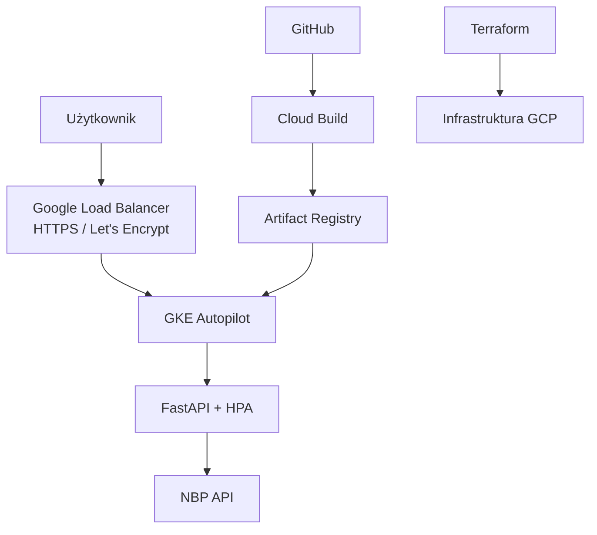

# NBP USD/PLN — infrastruktura

Infrastruktura aplikacji wdrożonej w Google Cloud Platform, zarządzana za pomocą **Terraform (Infrastructure as Code)**.

## Technologie

Terraform, Google Cloud, GKE Autopilot, Artifact Registry, Cloud Build, Kubernetes RBAC.

## Architektura

## Infrastruktura

- GKE Autopilot — uruchamianie kontenerów.
- Artifact Registry — przechowywanie obrazów Docker.
- Cloud Build — automatyzacja CI/CD.
- IAM i Kubernetes RBAC — kontrola uprawnień.
- Cert-manager i Let's Encrypt — obsługa certyfikatów HTTPS.
- Cloud Logging — centralne logi aplikacji.

**Środowisko:** `nbp-devops-prod`  
**Region:** `europe-central2`  
**Klaster:** `nbp-gke`

## Terraform CI/CD

1. Zmiany wprowadzane są przez Pull Request.
2. Komentarz `/gcbrun` uruchamia Terraform PLAN w Cloud Build.
3. Po weryfikacji następuje merge do `main`.
4. Merge uruchamia Terraform APPLY.

Stan Terraform przechowywany jest w Google Cloud Storage. Produkcyjny `terraform apply` wykonywany jest wyłącznie przez pipeline.

## Bezpieczeństwo

Zastosowano osobne konta serwisowe dla poszczególnych pipeline'ów oraz uprawnienia zgodne z zasadą **least privilege**.

Na potrzeby zadania repozytoria są publiczne, a proces zatwierdzania zmian uproszczony. W środowisku komercyjnym zastosowalibyśmy prywatne repozytoria, obowiązkowe code review, ochronę branchy i dodatkowe zatwierdzenie zmian produkcyjnych.

## Możliwe rozszerzenie

Na potrzeby zadania przygotowano tylko środowisko **PROD**.

W większym projekcie zastosowalibyśmy niezależne środowiska **DEV, STAGING i PROD**, każde z osobnym projektem GCP, zasobami i uprawnieniami.

Takie podejście ogranicza ryzyko wpływu testów i zmian rozwojowych na produkcję.